<!-- ─────────────────────────  HEADER  ───────────────────────── -->
<div align="center">

<a href="https://nocturnalcoders.dev">
  
</a>

<a href="https://nocturnalcoders.dev">
  
</a>

<br/>

<a href="https://nocturnalcoders.dev"></a>
<a href="https://www.linkedin.com/in/christianto-lie/"></a>
<a href="https://codepen.io/nocturnalcoders"></a>
<a href="https://twitter.com/nocturnalcoders"></a>


</div>

<br/>

<!-- ─────────────────────────  ABOUT  ───────────────────────── -->
## 🌙 &nbsp;About me

```ts
const nocturnalcoders = {
  name:      "Christianto Lie",
  aka:       ["ToLie", "NocturnalCoders"],
  based:     "Singapore 🇸🇬",
  role:      "Senior Backend Engineer · Technical Lead",
  company:   "🔒 classified (NDA life)",
  focus:     ["scalable backends", "system architecture", "clean code"],
  practices: ["KISS", "DRY", "TDD", "BDD"],
  exploring: ["AI agents & automation", "Web3 / smart contracts"],
  schedule:  "code at night ☕ → meetings (or sleep) in the morning 😴",
};
```

I design and build **high-performance, scalable applications** with solid system architecture: mostly on the backend, comfortable on the frontend, and always pushing for code that the next person can actually maintain.

<br/>

<!-- ─────────────────────────  NOW  ───────────────────────── -->
## ⚡ &nbsp;Right now

<table>
  <tr>
    <td width="50%" valign="top">

**🛠️ Building**
- AI agent teams that run 24/7 on Linux servers
- Telegram & Discord bots for real businesses
- Backend services in Java / Spring Boot & Go

</td>
    <td width="50%" valign="top">

**🔭 Exploring**
- Agentic workflows & LLM tooling
- Smart contracts with Solidity
- Infra hygiene: SSH, firewalls, zero-downtime ops

</td>
  </tr>
</table>

<br/>

<!-- ─────────────────────────  AI NIGHTLY LOG  ───────────────────────── -->
## 🤖 &nbsp;Nightly log <sub><sup>written by AI from my public GitHub activity</sup></sub>

<!-- AI-NIGHTLY:START -->
> 🌙 **Booting up…** The night shift hasn’t filed its first report yet. Check back after midnight Singapore time.
<!-- AI-NIGHTLY:END -->

<sub>Every night at 00:00 SGT a GitHub Action reads my latest public activity and asks Claude to write this log. No human edits.</sub>

<br/>

<!-- ─────────────────────────  STACK  ───────────────────────── -->
## 🧰 &nbsp;Tech stack

<div align="center">

**Backend**
<br/><br/>


<br/><br/>

**Frontend**
<br/><br/>


<br/><br/>

**Data · Web3 · Mobile**
<br/><br/>


<br/><br/>

**DevOps & Tools**
<br/><br/>


<br/><br/>

**Testing**
<br/><br/>


</div>

<br/>

<!-- ─────────────────────────  PROJECTS  ───────────────────────── -->
## 🚀 &nbsp;Featured work

| Project | What it is | Stack |
|:--|:--|:--|
| [**Commerce API suite**](https://github.com/nocturnalcoders/payment-api)<br/><sub>[payment](https://github.com/nocturnalcoders/payment-api) · [promocode](https://github.com/nocturnalcoders/promocode-api) · [e-voucher](https://github.com/nocturnalcoders/evoucher-api) · [e-store](https://github.com/nocturnalcoders/estore-api)</sub> | Four Java services covering payments, promo codes, e-vouchers and the store |  |
| [**e-Kost platform**](https://github.com/nocturnalcoders/BackendEkost)<br/><sub>[backend](https://github.com/nocturnalcoders/BackendEkost) · [core-ws](https://github.com/nocturnalcoders/core-ws) · [frontend](https://github.com/nocturnalcoders/ekost-frontend) · [owner app](https://github.com/nocturnalcoders/ownerkost)</sub> | Boarding-house (kost) platform built end to end: Go services and a Vue frontend |   |
| [**hris_frontend**](https://github.com/nocturnalcoders/hris_frontend) | HRIS web frontend with React + Vite |   |
| [**ait_imagerecognition_german**](https://github.com/nocturnalcoders/ait_imagerecognition_german) | Image recognition project in Python |  |
| [**portalstudycenter**](https://github.com/nocturnalcoders/portalstudycenter) | Spring Boot MVC + MySQL with role-based authorization (Spring Security) |  |
<br/>

<!-- ─────────────────────────  STATS  ───────────────────────── -->
## 📈 &nbsp;GitHub at night

<div align="center">


<br/>


<br/>


</div>

<br/>

<!-- ─────────────────────────  FOOTER  ───────────────────────── -->
<div align="center">

### 🌌 &nbsp;Still awake? Let’s build something.

<a href="https://nocturnalcoders.dev"><b>nocturnalcoders.dev</b></a>
&nbsp;·&nbsp;
<a href="https://www.linkedin.com/in/christianto-lie/"><b>LinkedIn</b></a>

<br/><br/>

<sub>✨ This README and its night-city artwork were generated with AI (Claude), then reviewed by a human who should probably be asleep.</sub>

<br/><br/>


</div>